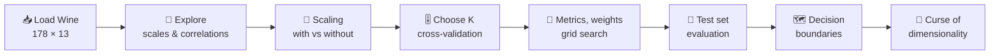
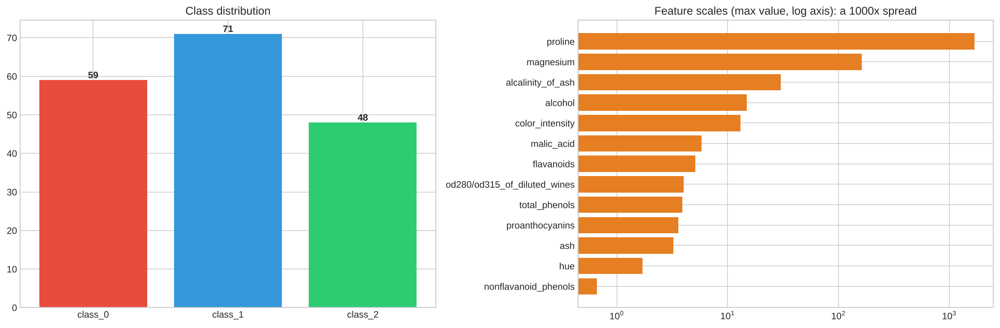
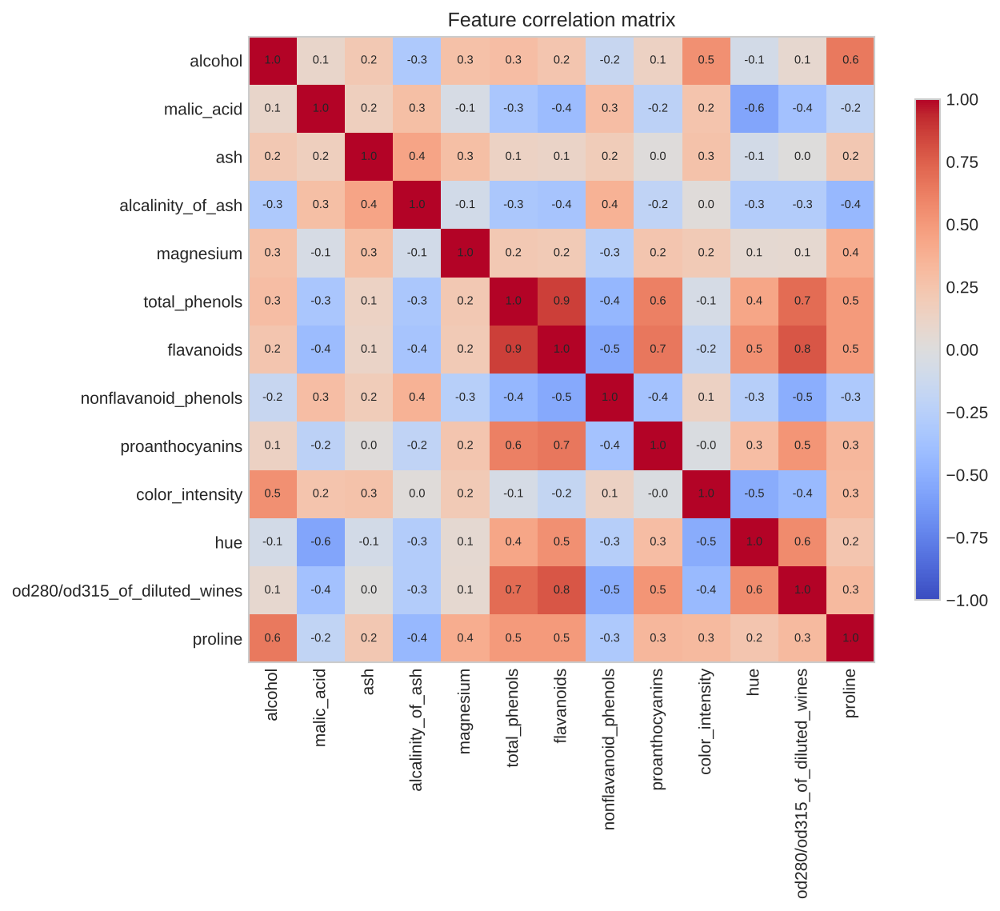
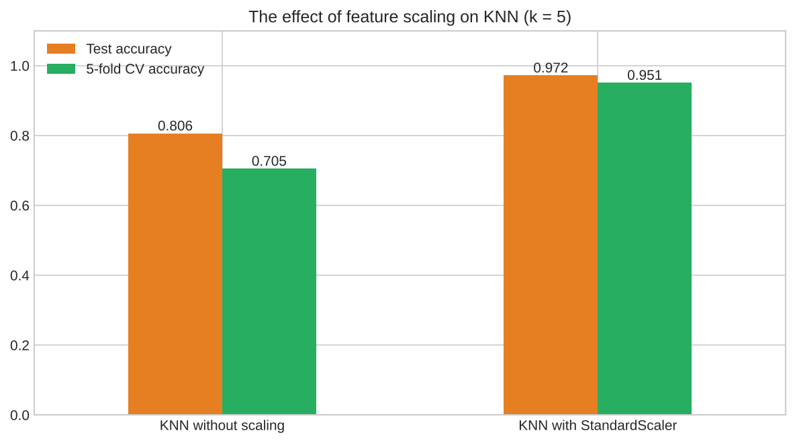
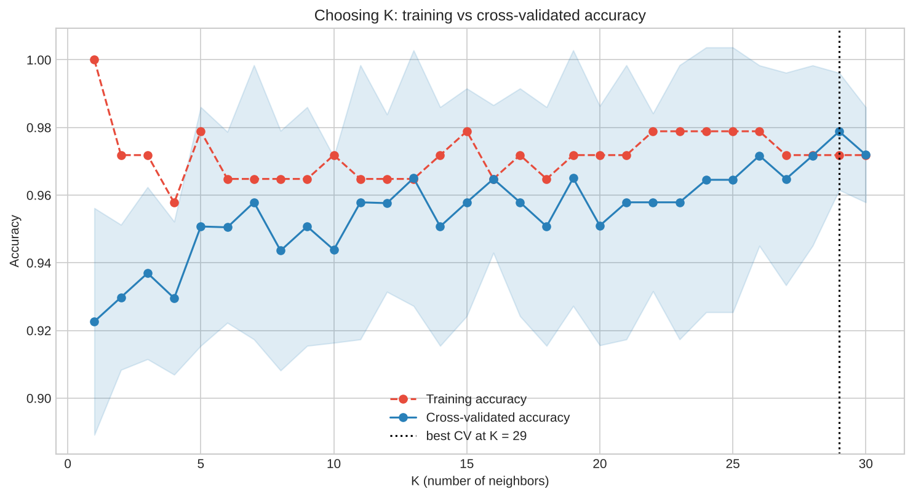
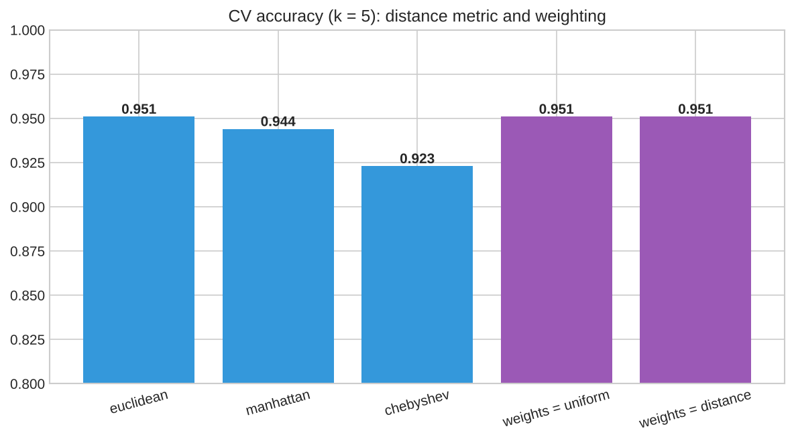
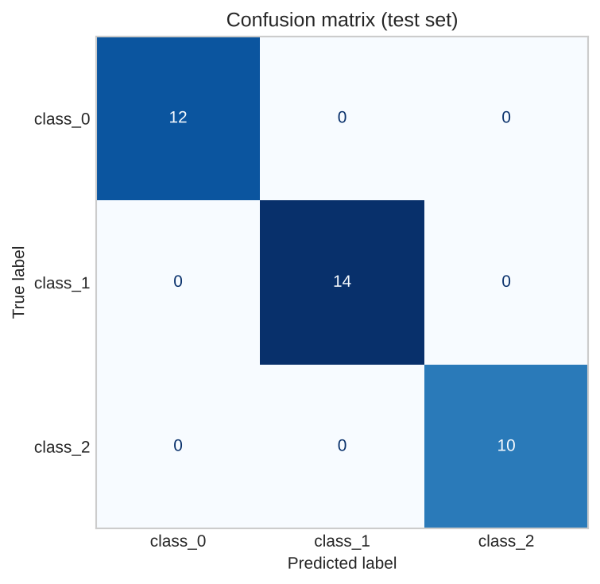
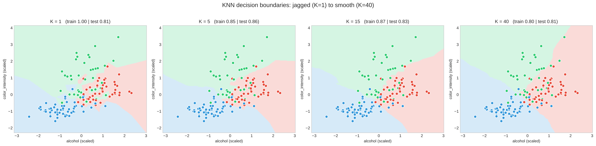
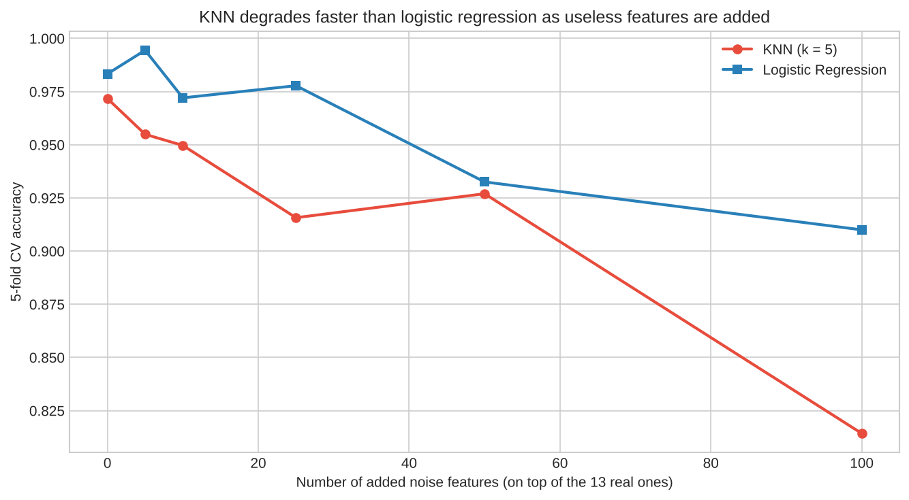

<div align="center">

# 🍷 Wine Classification with K-Nearest Neighbors (KNN)

### Scaling, choosing K, distance metrics, decision boundaries and the curse of dimensionality


</div>

---

## 🎯 Objective
Implement and understand **K-Nearest Neighbors** by classifying wines into 3 cultivars from their chemical analysis: feature scaling, choosing K with cross-validation, distance metrics and weighting, grid search, decision boundaries and the curse of dimensionality.

**Dataset:** the Wine dataset built into scikit-learn: **178 wines × 13 features**, 3 classes (59 / 71 / 48), no missing values. No download needed; a copy is saved in `data/wine.csv`.

## ⚡ Highlights

| | |
|---|---|
| 📏 **Scaling effect** | CV accuracy **0.705 → 0.951** with one `StandardScaler` |
| 🎚️ **K = 1** | Overfits: train 1.000, CV 0.923 |
| ✅ **Cross-validated accuracy** | **≈ 0.95 to 0.98** for K ≥ 5 (best 0.979) |
| 🔧 **Grid search (150 combos)** | K = 7, Manhattan, uniform weights, CV **0.979** |
| 🎯 **Test accuracy** | 1.000 on 36 wines (honest caveat: tiny test set, CV is more reliable) |
| 🌌 **Curse of dimensionality** | 100 noise features cost KNN **16 points** vs **7** for logistic regression |

## 🔄 Pipeline



## 📂 Project Structure

```
knn-wine-classification/
├── 📁 data/
│   └── wine.csv                   # Wine dataset (178 rows, 13 features + target)
├── 📁 images/                     # 8 plots generated by the notebook
├── 📓 knn_classification.ipynb    # full notebook with outputs
├── 📄 requirements.txt
└── 📄 README.md
```

## 🔎 Data Exploration


Feature scales differ enormously: `proline` runs from 278 to 1,680 (std ≈ 315) while `nonflavanoid_phenols` runs from 0.13 to 0.66 (std ≈ 0.12). KNN is distance-based, so big-number features would dominate.



## 📏 Why Scaling Matters


| Model (k = 5) | Test accuracy | 5-fold CV accuracy |
|---|---|---|
| KNN without scaling | 0.806 | 0.705 |
| KNN with `StandardScaler` | **0.972** | **0.951** |

Everything uses a **Pipeline** (scaler + KNN), so the scaler is fitted only on each training fold (no data leakage). The stratified split gives 142 training and 36 test wines.

## 🎚️ Choosing K (Bias–Variance Trade-off)


- **K = 1** memorises the training set (train 1.000) but generalises worst (CV 0.923)
- CV accuracy reaches about **0.95 to 0.97 for K ≥ 5**, then flattens (best **0.979 at K = 29**)
- The curve is flat, so differences between those K values are within noise: a moderate, odd K (5 to 15) is a safe choice

## 🔧 Distance Metrics, Weighting & Grid Search


| Setting (k = 5, CV) | Accuracy |
|---|---|
| Euclidean | 0.951 |
| Manhattan | 0.944 |
| Chebyshev | 0.923 |
| `weights='uniform'` / `'distance'` | 0.951 / 0.951 |

**GridSearchCV** (150 combinations, training data only) picked **K = 7, Manhattan, uniform weights** with CV accuracy **0.979**.

## 🎯 Test-Set Evaluation


Test accuracy **1.000** (36 of 36), macro F1 1.000. ⚠️ With only 36 test wines, one mistake would be 97.2% and the default K = 5 model scored 0.972, so the **cross-validated 0.95 to 0.98** is the more reliable number. Wine is an easy dataset; the goal here is to understand KNN.

## 🗺️ Decision Boundaries


Using two features (`alcohol`, `color_intensity`): **K = 1** gives a jagged, overfit boundary; **K = 5 to 15** a smooth one that follows the data (best test accuracy at K = 5: 0.86 in this 2D view); **K = 40** over-smooths and underfits.

## 🌌 The Curse of Dimensionality


| Noise features added | KNN | Logistic Regression |
|---|---|---|
| 0 | 0.972 | 0.983 |
| 10 | 0.950 | 0.972 |
| 50 | 0.927 | 0.933 |
| 100 | **0.814** | **0.910** |

KNN treats every feature equally, so useless features erode the distance. Feature selection or PCA matters a lot for KNN.

## ▶️ How to Run
```bash
git clone https://github.com/D0027/knn-wine-classification.git
cd knn-wine-classification
pip install -r requirements.txt
jupyter notebook knn_classification.ipynb
```
Also runs on Kaggle: import the notebook and click **Run All** (no dataset to add).

## 🎤 Interview Questions

<details>
<summary><b>1. How does KNN work?</b></summary>

To predict a point, find its K closest training points (by a distance metric) and take a majority vote (classification) or the average (regression). There is no real training: it stores the data (a **lazy learner**).
</details>

<details>
<summary><b>2. How do you choose K?</b></summary>

With cross-validation: try a range of K and pick the best CV score, watching the bias-variance trade-off. Prefer odd K for binary problems to avoid ties, and a simpler (larger) K when scores are tied.
</details>

<details>
<summary><b>3. Why is feature scaling important?</b></summary>

KNN uses distances, so features with large numeric ranges dominate. Here scaling raised CV accuracy from 0.705 to 0.951. Fit the scaler on training data only (use a Pipeline).
</details>

<details>
<summary><b>4. Which distance metrics can be used?</b></summary>

Euclidean (default), Manhattan (better with many dimensions or outliers), Minkowski (general form), Chebyshev, cosine (text / sparse data), Hamming (categorical).
</details>

<details>
<summary><b>5. What is the curse of dimensionality?</b></summary>

In high dimensions the distances between points become nearly equal, so "nearest" loses meaning and irrelevant features swamp the signal. Fix with feature selection or PCA, and more data.
</details>

<details>
<summary><b>6. What is the bias-variance trade-off in KNN?</b></summary>

Small K means low bias and high variance (jagged boundary, overfits). Large K means high bias and low variance (over-smooth, underfits).
</details>

<details>
<summary><b>7. Pros and cons of KNN?</b></summary>

Pros: simple, no training, naturally multiclass, non-linear boundaries. Cons: slow prediction and high memory on large data, sensitive to scale, noise, irrelevant features and imbalanced classes.
</details>

<details>
<summary><b>8. What is the time complexity?</b></summary>

Training is O(1) (just store the data); prediction is O(n · d) per query by brute force. KD-trees, ball trees or approximate nearest neighbors speed it up in low dimensions.
</details>

<details>
<summary><b>9. Can KNN do regression?</b></summary>

Yes: predict the (optionally distance-weighted) average of the K neighbors' target values (`KNeighborsRegressor`).
</details>

<details>
<summary><b>10. How do you handle class imbalance in KNN?</b></summary>

Use distance weighting, resampling (SMOTE / undersampling), stratified splits and metrics such as F1 or recall, because the majority class dominates the vote.
</details>

<details>
<summary><b>11. What does <code>weights='distance'</code> do?</b></summary>

Closer neighbors get larger votes (weight = 1 / distance), which helps when classes overlap or K is large.
</details>

## 👤 Author

**Deepak Yadav**

[](https://github.com/D0027)
[](https://linkedin.com/in/deepakyadav027)
[](https://d0027.github.io)
